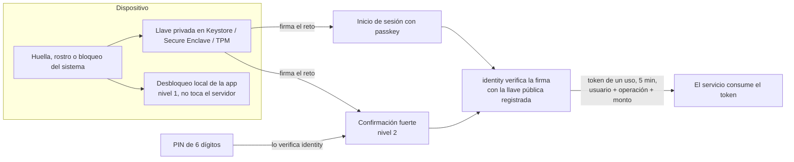
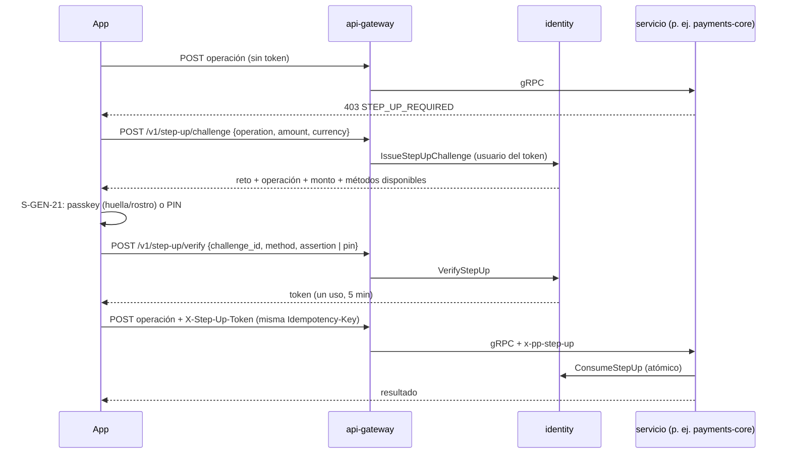

# Biometría, passkeys y capacidades del dispositivo

Documento de diseño aprobado por el dueño del producto el 2026-10-20 a partir de la propuesta del
2026-10-19. Decisión: [ADR 0020](../adr/0020-webauthn-autenticacion-fuerte.md). Normas que lo
desarrollan: [`security-standards.md`](../standards/security-standards.md) §2.6, §4 y §10,
[`flutter-standards.md`](../standards/flutter-standards.md) §2 y §9, [`identity/SPEC.md`](../../identity/SPEC.md)
R25–R32 y [`api-gateway/SPEC.md`](../../api-gateway/SPEC.md). Capacidades:
[`business-profiles-and-access.md`](../domain/business-profiles-and-access.md) §4.1.

## 1. Propósito y alcance

PlentyPay usa la huella o el rostro para tres cosas: **desbloquear la app** en el dispositivo,
**iniciar sesión sin contraseña** y **confirmar acciones sensibles**. La biometría nunca sale del
teléfono o la computadora; el servidor solo verifica una firma criptográfica estándar
(WebAuthn/passkeys) que el dispositivo produce después de reconocer a la persona, o un PIN que
verifica `identity`.

- Los permisos dicen *qué* puede hacer alguien; la verificación dice *si de verdad es esa persona,
  ahora*. La confirmación fuerte nunca concede permisos: solo desbloquea, una vez, algo que el rol ya
  permite.
- Alcance: `flutter_app` en sus seis plataformas, `identity`, `api-gateway`, `web` (archivos
  `.well-known`), `infra-management` (configuración) y `security` (eventos), más la capa común de
  **capacidades del dispositivo** (biometría, passkeys, almacenamiento seguro, cámara, fotos, NFC,
  ubicación, notificaciones), porque todas se piden, explican y revocan igual.

## 2. Diagnóstico (2026-10-20) y estado de cada hallazgo

| # | Hallazgo | Gravedad | Estado |
|---|---|---|---|
| B1 | La confirmación fuerte de la app era simulada (aceptaba cualquier PIN de 4+ dígitos salvo `0000`) | Crítica | **Contenido** el 2026-10-20 (S-GEN-21 dejó de comparar un PIN local); la verificación real llega con R25–R28 |
| B2 | identity emite el token sin verificar la firma (`VerifyChallenge` ignora la aserción; opciones fijas con `rpId` `plentypay.internal`) | Crítica | Se corrige con R25 y R27; F05.6 vuelve a 📝 hasta que pasen |
| B3 | Retos y tokens viven en memoria (`StepUpManager` con mapas) | Alta | Migración `0011_strong_auth` |
| B4 | El usuario del reto sale del cuerpo; los errores se devuelven como token vacío | Alta | R26 y errores con `reason` |
| B5 | Passkeys sin implementar (RPC «no implementado», sin rutas ni tabla) | Alta | F28.2, sin depender de F28.1 |
| B6 | La app no tiene `local_auth` ni `passkeys`; `MainActivity` extiende `FlutterActivity` | Media | F23.3 / F23.8 |
| B7 | Falta `get_login_creds` en `assetlinks.json` y `webcredentials` en el AASA | Media | `web`, desde variables de entorno |
| B8 | El umbral del step-up está fijo en la pantalla de pago | Media | El umbral lo decide payments-core con `stepup.threshold_minor`; la app solo reacciona a `STEP_UP_REQUIRED` |
| B9 | Faltan S-GEN-22 (bloqueo) y «Entrar con huella o rostro»; Seguridad muestra un nivel fijo | Media | F23.3 / F28.2 |
| B10 | No hay PIN en el servidor | Media | R28 |
| B11 | La pantalla de permisos no tiene ficha | Baja | Ficha S-GEN-23 |
| B12 | `ChangePassword` solo comprueba que el token no esté vacío: nunca lo consume, y toma el usuario del cuerpo | Crítica | R26 con la operación `identity.password.change` |

Se conserva: la vinculación del token a usuario, operación, monto y moneda, de un solo uso, con
`MISMATCH`, `EXPIRED` y `ALREADY_USED`; `STEP_UP_REQUIRED` en el gateway; los tokens de sesión en
`flutter_secure_storage`; y las reglas N-PAG-05, N-STD-41 y N-DAT-04.

## 3. Principios

1. **La biometría no sale del dispositivo.** Ni plantilla, ni imagen, ni el resultado «sí/no» viajan
   al servidor (N-DAT-04).
2. **El servidor solo confía en firmas o en lo que él mismo verifica.** Acepta una aserción WebAuthn
   verificada contra la llave pública registrada, el reto, el origen, el `rpId` y el contador, o un PIN
   que compara con su hash. El `true` de `local_auth` nunca es prueba.
3. **La biometría desbloquea una llave; no es una contraseña.** Si cambian las huellas o rostros del
   sistema operativo, las llaves ligadas a ellos dejan de servir y se pide la contraseña.
4. **Siempre hay alternativa**: bloqueo de pantalla del sistema, PIN o contraseña; nunca biometría
   como única vía (WCAG 3.3.8, N-STD-41).
5. **Es voluntario y revocable**, por dispositivo, desde Seguridad (S-GEN-10).
6. **Una confirmación sirve para una sola operación**: ligada a usuario, operación, monto y moneda, un
   solo uso, 5 minutos.
7. **Se confirma lo que dice el servidor.** La operación y el monto que ve la persona vienen de la
   respuesta del reto, no de la pantalla que lo pide (S-GEN-21 e2).
8. **Ningún control de dinero es solo local** (AGENTS.md §2.12). Sin passkey, el respaldo es un PIN
   verificado en el servidor.
9. **Una sola tecnología en el servidor**: WebAuthn (FIDO2) con `github.com/go-webauthn/webauthn`
   (BSD-3, versión fija) en `identity`; sin proveedores externos de autenticación (ADR 0001).
10. **Las capacidades del dispositivo se piden al usarlas**, con una explicación previa, y se revisan o
    revocan en una sola pantalla (S-GEN-23).

## 4. Modelo: tres usos, una sola verificación en el servidor

El desbloqueo local es el único uso que no toca el servidor: protege la pantalla, no autoriza
operaciones. Todo lo que mueve dinero pasa por identity y el servicio solo actúa al consumir el token.

## 5. Capacidades por plataforma

| Plataforma | Desbloqueo local | Passkeys | Almacenamiento seguro | Configuración nativa | Respaldo |
|---|---|---|---|---|---|
| Android (min. SDK 24) | `local_auth` (BiometricPrompt) | `passkeys` sobre Credential Manager | Keystore | `MainActivity` → `FlutterFragmentActivity`; tema `Theme.AppCompat`; `get_login_creds` en `assetlinks.json` | Bloqueo del sistema, luego PIN |
| iOS (mín. 15.0) | `local_auth` (Face ID / Touch ID) | AuthenticationServices, iOS 16+ (Q-41) | Keychain | Associated Domains `webcredentials:<dominio>`; `webcredentials` en el AASA | Código del dispositivo, luego PIN |
| macOS | Touch ID | `passkeys` | Keychain | Associated Domains y grupo de llavero en los `.entitlements` | PIN |
| Windows 10+ | Windows Hello | `passkeys` sobre Windows Hello | DPAPI | — | PIN de Windows Hello, luego PIN |
| Linux | No disponible | No disponible | libsecret | — | PIN y contraseña |
| Web | No aplica | WebAuthn del navegador | La del navegador | El `rpId` debe coincidir con el dominio | PIN |

**Dominio de las passkeys (`rpId`, Q-39).** Todas las plataformas comparten un solo `rpId`: un
dominio registrable estable donde se sirven los `.well-known` (200, `application/json`, sin
redirecciones). Hoy producción se publica por un túnel cuya URL cambia (ADR 0019): **mientras no
exista ese dominio, las passkeys quedan apagadas** (`WEBAUTHN_RP_ID` vacío → `PASSKEYS_UNAVAILABLE`)
y la confirmación fuerte funciona con el PIN en todas las plataformas.

**Versiones.** `passkeys` exige Dart ≥ 3.9 y Flutter ≥ 3.35 (el proyecto compila con 3.47.6); se
suben las restricciones del `pubspec.yaml`. `go-webauthn/webauthn` se fija a una versión exacta.

## 6. Registro de capacidades del dispositivo

La app tiene un único registro (`flutter_app/lib/core/device/`) que responde, para cada capacidad:
si el equipo la soporta, si está configurada (p. ej. huellas registradas), el estado del permiso del
sistema, si la persona la activó en PlentyPay y, si no está disponible, por qué. Las pantallas
consultan el registro en vez de llamar a cada plugin.

| Capacidad | Para qué | Permiso del sistema | Cuándo se pide | Paquete | Plataformas |
|---|---|---|---|---|---|
| `device.biometrics` | Desbloquear la app | iOS: texto de Face ID. Android: `USE_BIOMETRIC` | Al activar «Entrar con huella o rostro» | `local_auth` | Android, iOS, macOS, Windows |
| `device.passkeys` | Iniciar sesión y confirmar | Ninguno | Al crear la llave | `passkeys` | Todas menos Linux |
| `device.secure_storage` | Guardar la sesión | Ninguno | Siempre | `flutter_secure_storage` | Todas |
| `device.camera` | Escanear QR y códigos de barras; marcaje facial | Cámara | Al abrir el escáner o el quiosco | `mobile_scanner`, `image_picker` | Móviles y web |
| `device.photos` | Fotos de productos y documentos | Galería | Al elegir una imagen | `image_picker` | Móviles |
| `device.nfc` | Pagar acercando el teléfono; grabar etiquetas | NFC | Al usar NFC | F23.2 | Android, iOS |
| `device.location` | Marcajes y entregas | Ubicación en uso | Al iniciar turno | F14 | Móviles |
| `device.notifications` | Avisos de pagos, pedidos y seguridad | Notificaciones | Tras el primer cobro o al activar avisos | F20.4 | Todas |

Reglas:
1. **Nunca se piden permisos al abrir la app.** Antes del diálogo del sistema se muestra una hoja que
   explica para qué es y qué no se hace con el dato; si se niega de forma permanente, se ofrece abrir
   los ajustes.
2. **Una sola pantalla para revisarlo todo** (S-GEN-23, `/account/permissions`). Biometría y
   passkeys enlazan a Seguridad (S-GEN-10), donde se activan.
3. **El registro no envía al servidor** datos biométricos ni su disponibilidad. El servidor conoce
   solo la llave pública de cada passkey y la etiqueta del dispositivo que elige la persona.
4. **Capacidades de negocio que dependen del dispositivo** (`business-profiles-and-access.md`
   §4.1): si falta el hardware, la app lo explica y ofrece la alternativa; nunca falla en silencio.
5. **Las pruebas usan una implementación falsa del registro**: cada estado (no soportado, sin
   configurar, denegado, activo) tiene su widget test.

## 7. Qué acción exige qué verificación

| Nivel | Nombre | Qué prueba | Métodos |
|---|---|---|---|
| 0 | Sesión | Que la petición viene de una sesión válida | Token de acceso |
| 1 | Presencia en el dispositivo | Que quien sostiene el equipo es su dueño | Biometría o bloqueo del sistema. Solo en el cliente; el PIN nunca se verifica en la app (R28) |
| 2 | Confirmación fuerte | Que esa persona autoriza **esta** operación y **este** monto | `PASSKEY` con verificación de usuario; respaldo `PIN` verificado por identity |
| 3 | Reautenticación | Que conoce la credencial principal | `PASSWORD` |

El catálogo de operaciones (nombre estable, nivel y métodos) está en `security-standards.md` §4.1 y
lo aplica identity (R27). Abrir la app tras inactividad (C-18, `session.idle_lock_minutes.*`) y
activar o desactivar la biometría en el dispositivo son nivel 1; cerrar las demás sesiones también
(acción de protección, sin fricción).

## 8. Flujos

### 8.1 Confirmar una operación

Si la persona cancela, la operación no ocurre y el reto vence solo.

### 8.2 Activar «Entrar con huella o rostro» (S-GEN-10)
1. La persona enciende el interruptor; sin biometría configurada, la app explica cómo hacerlo.
2. Una hoja explica qué se guarda y qué no. Se pide nivel 3 si es su primera passkey, nivel 2 si ya
   tiene otra.
3. `register/begin` → el sistema crea la passkey → `register/finish` con el nombre del dispositivo.
4. La app activa el desbloqueo local en ese equipo.
5. `pp.identity.passkey.registered.v1` llega a notifications, que avisa por correo y en la bandeja.

### 8.3 Entrar con passkey
`login/begin` sin correo → el sistema muestra las passkeys del dominio → firma → `login/finish` →
sesión. Si falla o se cancela, el formulario de correo y contraseña sigue ahí, sin revelar si la
cuenta existe.

### 8.4 Bloqueo por inactividad (S-GEN-22)
Pasados `session.idle_lock_minutes.*`, la app cubre la pantalla; se desbloquea con biometría o con el
bloqueo del sistema; «Cerrar sesión» siempre visible. No llama al servidor.

### 8.5 Recuperar el acceso
- Perdió el teléfono: desde otro equipo cierra esa sesión y elimina su passkey.
- Olvidó la contraseña: el restablecimiento (R16) cierra todas las sesiones; las passkeys siguen
  válidas y se listan en el aviso.
- Cambió las huellas del equipo: el desbloqueo local pide la contraseña una vez.

### 8.6 Desactivar
Apagar el interruptor quita el desbloqueo local y ofrece eliminar la passkey de ese equipo (nivel 2).
Sin passkeys quedan la contraseña y el PIN.

## 9. Servidor

Detalle normativo en `identity/SPEC.md` §3, §4 y R25–R32, y en `api-gateway/SPEC.md`.

- **Relying party**: `WEBAUTHN_RP_ID`, `WEBAUTHN_RP_NAME` («PlentyPay») y `WEBAUTHN_ORIGINS` (web
  `https://<dominio>` y `android:apk-key-hash:<hash>` por certificado de firma).
- **Política WebAuthn**: verificación de usuario obligatoria, llave residente obligatoria, atestación
  `none`.
- **PIN**: 6 dígitos con el mismo esquema que la contraseña; `stepup.pin.max_attempts` (3) intentos
  y `stepup.pin.lock_minutes` (5) de bloqueo, desde configuración, con evento a security.
- **Datos**: `passkeys`, `webauthn_challenges`, `step_up_tokens` (solo el hash del token),
  `step_up_pins` y `sessions.auth_method`, con RLS por usuario.
- **Eventos**: `pp.identity.passkey.registered.v1`, `pp.identity.passkey.revoked.v1`; a security,
  `STEP_UP_FAILED`, `PIN_LOCKED` y `PASSKEY_COUNTER_REGRESSION`.

## 10. Amenazas y controles

| Amenaza | Control |
|---|---|
| Teléfono desbloqueado en manos de otra persona | Bloqueo por inactividad y nivel 2 para todo lo que mueve dinero |
| Sitio o app falsos | La firma WebAuthn queda ligada al origen y al `rpId` |
| Repetir una firma capturada | Reto de un solo uso con `consumed_at` |
| Robo del token de confirmación | Un uso, 5 min, ligado a usuario, operación y monto; solo se guarda su hash |
| Llave clonada | Contador que retrocede (si es > 0) → rechazo y `PASSKEY_COUNTER_REGRESSION` |
| Alguien que conoce el código del teléfono | Aviso ante cada passkey nueva, lista de dispositivos, topes, revocación remota |
| Fuerza bruta del PIN | Intentos y bloqueo desde configuración, evento a security; nunca se verifica en la app |
| Pérdida o robo del equipo | Revocar sesiones y passkeys desde otro dispositivo |
| Root o jailbreak | F28.3 |
| Otra app superpuesta al diálogo (Android) | El diálogo descarta toques cuando otra ventana lo cubre |
| Capturas | C-19 |
| Fugas en la telemetría | Nunca se registran aserciones, retos, tokens ni PIN; el id de la credencial se enmascara |

## 11. Privacidad y accesibilidad

- Con passkeys, PlentyPay **no trata datos biométricos**: guarda la llave pública, el nombre del
  dispositivo, las fechas y el `aaguid`. La confirmación legal de este criterio es Q-40.
- El marcaje facial de nómina es otro caso (plantilla cifrada con consentimiento separado, §10 de
  `security-standards.md`) y nunca sirve para iniciar sesión.
- Textos (`es_PA`/`en`): «Entrar con huella o rostro», «Confirma que eres tú», «Tu huella o tu rostro
  nunca salen de este dispositivo», «Usar PIN». Ninguno promete que la biometría es infalible.
- WCAG 2.2 AA: siempre hay una vía sin memorizar (passkey, o contraseña con gestor y pegado); el
  botón biométrico anuncia «Confirmar con huella o rostro»; el PIN anuncia los dígitos ingresados
  sin leerlos; el reto dura 5 minutos y, si vence, se pide otro sin perder la operación; la hoja de
  confirmación es desplazable al 200 %; un solo botón `filled` por pantalla.

## 12. Pruebas

- **identity**: autenticador virtual (llaves ES256 generadas en la prueba que arman
  `clientDataJSON` y `authenticatorData` reales) para R25, R29 y R30; PIN real contra base efímera
  para R27 y R28.
- **App**: cada estado del registro de capacidades, la hoja de confirmación (orden de métodos, PIN,
  semántica, 200 %), la pantalla de bloqueo.
- **E2E** (`scripts/e2e-identity-gateway.sh`): crear PIN, confirmar una operación, comprobar que una
  segunda verificación con el mismo reto falla.
- **Matriz L4** en equipos reales (Android, iOS, Windows, macOS, Linux, Web) cuando exista el dominio
  de Q-39.

## 13. Plan de adopción

1. Contención (hecho el 2026-10-20: S-GEN-21 sin PIN local) y F05.6 → 📝.
2. Documentación (hecho el 2026-10-20: este documento, ADR 0020, normas, SPEC, fichas S-GEN-02, S-GEN-10, S-GEN-21 a S-GEN-23, glosario, preguntas Q-39–Q-44 y contrato `identity.proto`).
3. identity: migración, PIN, política por operación, verificación real, passkeys, eventos.
4. web: `get_login_creds` y `webcredentials` desde variables de entorno.
5. api-gateway: rutas, usuario desde el token, cuerpo de `STEP_UP_REQUIRED`.
6. infra-management: `stepup.pin.max_attempts`, `stepup.pin.lock_minutes`,
   `session.idle_lock_minutes.mobile|pos|kiosk`.
7. flutter_app: paquetes, `FlutterFragmentActivity`, registro de capacidades (F23.8), S-GEN-21 real,
   S-GEN-22, S-GEN-10, inicio con passkey, S-GEN-23.
8. F28.3: root/jailbreak y fijación de certificados.

## 14. Implementaciones futuras

Passkey obligatoria para dueños y roles con dinero (Q-42); aprobación remota de devoluciones por la
supervisora (F20); entrar a la caja de escritorio escaneando con el teléfono; llaves FIDO2 para el
equipo de plataforma (lista de `aaguid`); atestación de la app (Q-44); extensión PRF para cifrar
datos locales del POS; verificación basada en riesgo; Secure Payment Confirmation (Q-03);
credenciales verificables de Gravital ID (Q-28). Todas reutilizan el mismo reto, la misma política
por operación y la misma tabla de passkeys.
